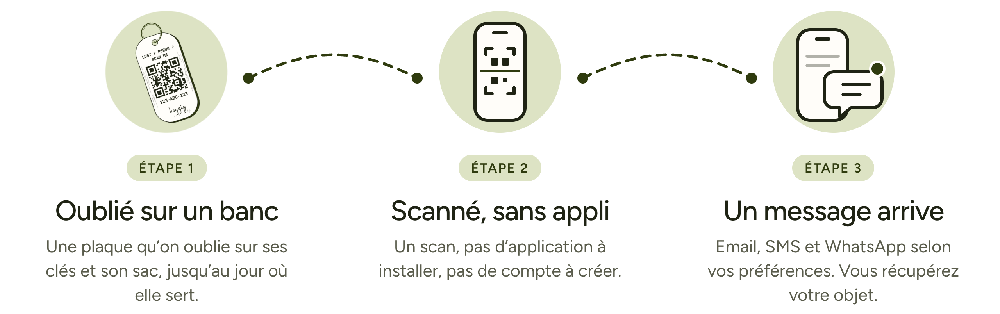

<a href="https://keyzig.com">
  <picture>
    <source media="(prefers-color-scheme: dark)" srcset="assets/banner-v2-dark.png">
    <source media="(prefers-color-scheme: light)" srcset="assets/banner-v2-light.png">
    
  </picture>
</a>

 
 

### La plupart des objets perdus sont retrouvés. Peu reviennent.

Écrire ses coordonnées n’est pas toujours une bonne idée. 
Keyzig crée ce lien en protégeant votre anonymat.

 

## Comment ça marche

 

<picture>
  <source media="(prefers-color-scheme: dark)" srcset="assets/steps-v5-dark.png">
  <source media="(prefers-color-scheme: light)" srcset="assets/steps-v5-light.png">
  
</picture>

 
 

## Mettez toutes les chances de votre côté.

Service compris à vie, sans abonnement.

 

<a href="https://keyzig.com">
  <picture>
    <source media="(prefers-color-scheme: dark)" srcset="assets/cta-dark.png">
    <source media="(prefers-color-scheme: light)" srcset="assets/cta-light.png">
    
  </picture>
</a>

 
 

<a href="https://keyzig.com"><b>keyzig.com</b></a>

 

<i>One tag. Endless ways to stay in touch.</i>

