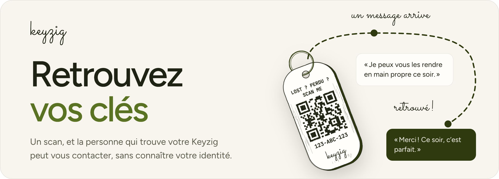
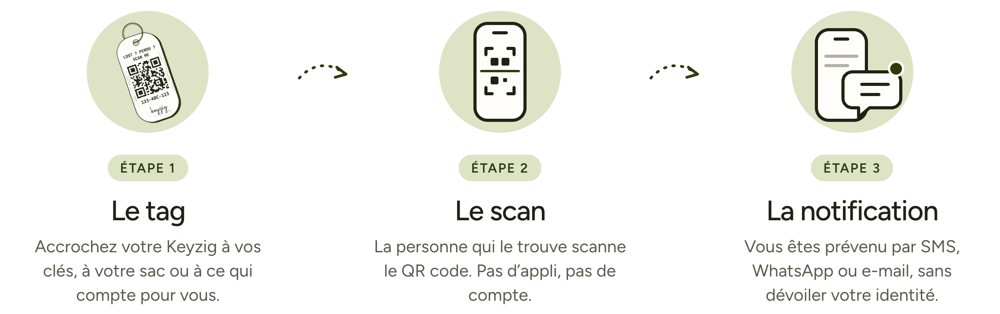
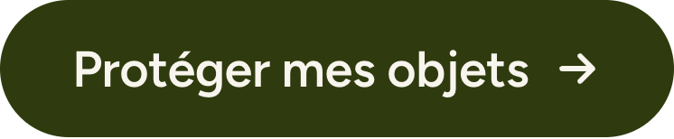

<a href="https://keyzig.com">
  <picture>
    <source media="(prefers-color-scheme: dark)" srcset="assets/banner-v2-dark.png">
    <source media="(prefers-color-scheme: light)" srcset="assets/banner-v2-light.png">
    
  </picture>
</a>

 
 

Keyzig fait des porte-clés à QR code. 
Le jour où vous perdez vos clés, celui qui les trouve n’a qu’à scanner le QR code&nbsp;: vous êtes prévenu aussitôt.

 

## Comment ça marche

 

<picture>
  <source media="(prefers-color-scheme: dark)" srcset="assets/steps-v3-dark.png">
  <source media="(prefers-color-scheme: light)" srcset="assets/steps-v3-light.png">
  
</picture>

 
 

## Mettez toutes les chances de votre côté.

 

<a href="https://keyzig.com">
  <picture>
    <source media="(prefers-color-scheme: dark)" srcset="assets/cta-dark.png">
    <source media="(prefers-color-scheme: light)" srcset="assets/cta-light.png">
    
  </picture>
</a>

 
 

<a href="https://keyzig.com"><b>keyzig.com</b></a>

 

<i>Lost something? Keyzig helps it find its way back to you.</i>

